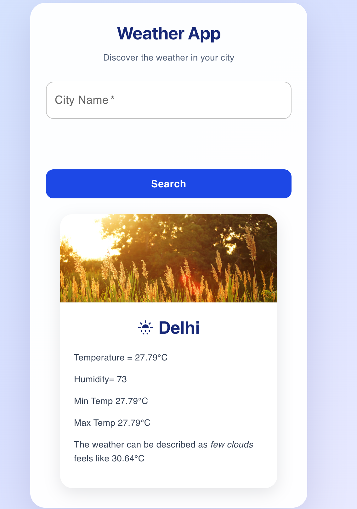

# 🌦️ Weather App

A responsive weather application built with **React and Material UI** that allows users to search for a city and view its current weather conditions, temperature, humidity, and more.

## 📸 Preview

## 📸 Preview

<p align="center">
  
</p>

<p align="center">
  <a href="https://ibb.co/VcGT41BF">View Full Screenshot</a>
</p>

> **Note:** Replace `PASTE_DIRECT_IMAGE_URL_HERE` with the direct image URL from ImgBB's Embed options to display the screenshot inside this README.

## ✨ Features

* 🔍 **City Search** — Search for weather information by city name.
* 🌡️ **Temperature Details** — View current, minimum, and maximum temperatures.
* 💧 **Humidity Information** — Check the current humidity level.
* 🌤️ **Weather Conditions** — View weather descriptions and the feels-like temperature.
* 🎨 **Dynamic Weather Cards** — Weather information is presented in a clean Material UI card.
* 📱 **Responsive UI** — Designed to provide a straightforward user experience across screen sizes.
* ⚡ **Real-Time API Data** — Fetch weather information using the OpenWeatherMap API.

## 🛠️ Tech Stack

| Technology         | Purpose                           |
| ------------------ | --------------------------------- |
| React              | Component-based user interface    |
| JavaScript (ES6+)  | Application logic                 |
| Material UI        | UI components and styling         |
| CSS3               | Custom styling                    |
| OpenWeatherMap API | Weather data                      |
| Vite               | Development server and build tool |

## 🚀 Getting Started

Follow these steps to run the project locally.

### Prerequisites

* Node.js and npm
* An OpenWeatherMap API key

### 1. Clone the repository

```bash
git clone YOUR_GITHUB_REPOSITORY_URL
```

### 2. Navigate to the project directory

```bash
cd mini-project-react
```

### 3. Install dependencies

```bash
npm install
```

### 4. Configure environment variables

Create a `.env` file in the project root, alongside `package.json`, and add:

```env
VITE_WEATHER_API_KEY=your_api_key_here
```

In `SearchBox.jsx`, access the key using:

```javascript
const API_KEY = import.meta.env.VITE_WEATHER_API_KEY;
```

Replace `your_api_key_here` with your own OpenWeatherMap API key.

**Security note:** Vite exposes variables prefixed with `VITE_` to browser-side code. For production applications, use a backend to protect API credentials where supported.

### 5. Start the development server

```bash
npm run dev
```

Open the local URL displayed in your terminal to use the application.

## 🌐 API Reference

Weather data is provided by the OpenWeatherMap Current Weather Data API.

* [OpenWeatherMap API Documentation](https://openweathermap.org/current)
* [OpenWeatherMap](https://openweathermap.org/)

## 📂 Project Structure

```text
mini-project-react/
├── public/
├── src/
│   ├── components/
│   ├── WeatherApp.jsx
│   ├── SearchBox.jsx
│   ├── InfoBox.jsx
│   ├── InfoBox.css
│   ├── SearchBox.css
│   └── index.css
├── .env
├── .gitignore
├── index.html
├── package.json
└── README.md
```

*The structure above is illustrative; adjust it to match the actual folders and files in your repository.*

## 🔮 Future Improvements

* Display a multi-day weather forecast.
* Add weather icons based on API conditions.
* Show wind speed, pressure, and visibility.
* Improve loading states and error messages.
* Add automatic location-based weather information.

## 👨‍💻 Author

**Abhishek Jha**

* GitHub: [Your GitHub Profile](https://github.com/jhasabhishek17)

---

<p align="center">
  If you find this project useful, consider giving it a ⭐ on GitHub.
</p>
